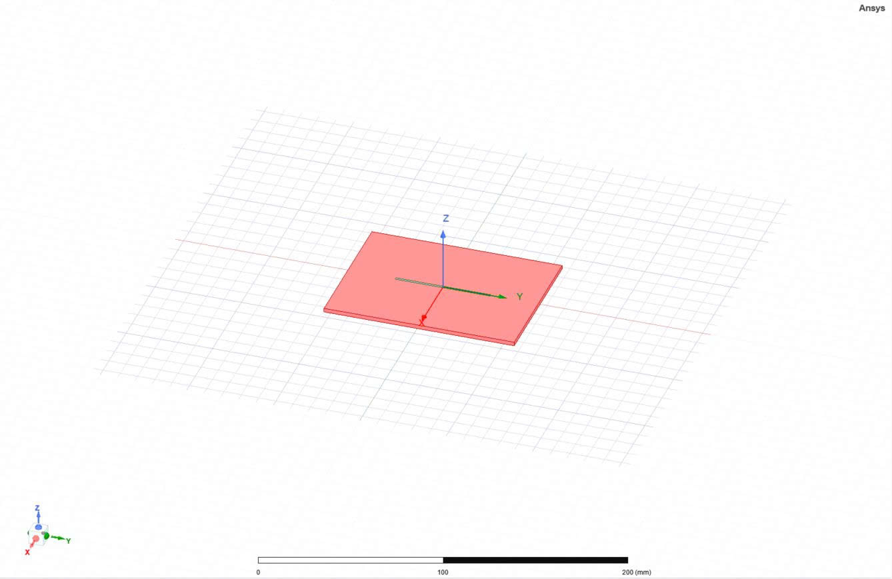
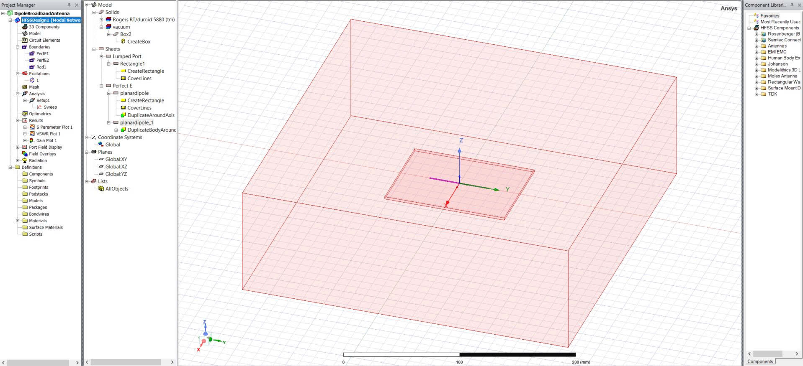
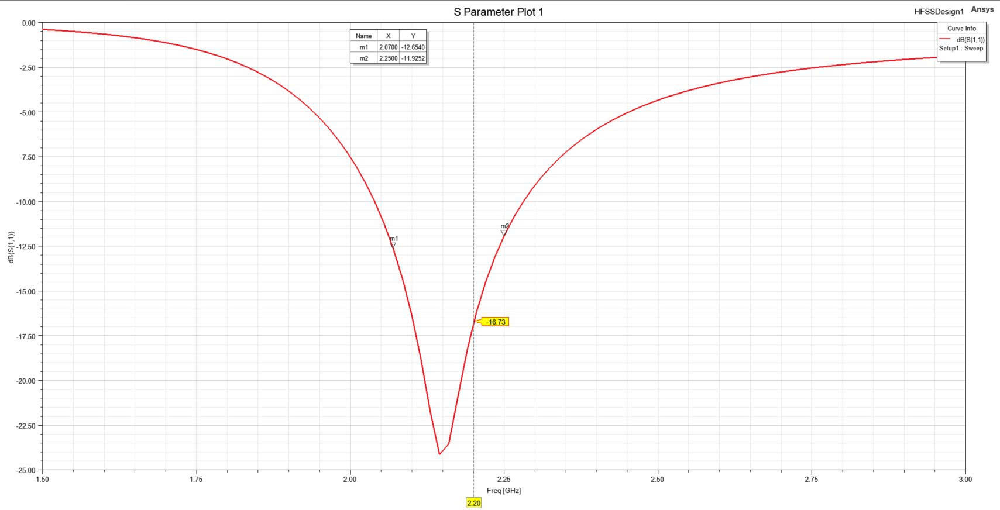
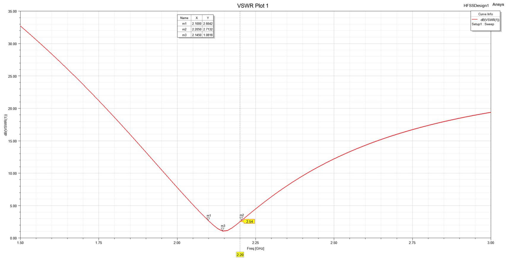
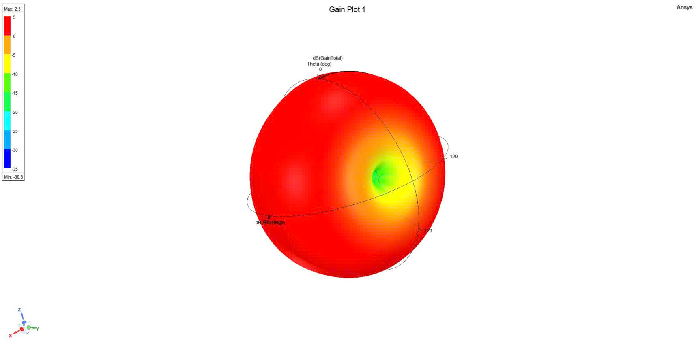

# Broadband Dipole Antenna Design Using Ansys HFSS

## Overview

This project presents the design and electromagnetic simulation of a broadband dipole antenna using Ansys HFSS.

The antenna model was developed and simulated to investigate its electromagnetic performance over the 1.5–3.0 GHz frequency range. The project includes the HFSS source file and selected simulation results for documentation and portfolio purposes.

## Software and Tools

- Ansys Electronics Desktop
- Ansys HFSS
- Electromagnetic simulation and 3D antenna modeling

## Antenna Model

The antenna was modeled as a 3D electromagnetic structure in Ansys HFSS.



*Figure 1. 3D model of the broadband dipole antenna designed in Ansys HFSS.*

## Simulation Setup

The HFSS simulation setup includes the antenna model, air box, boundary conditions, and lumped port used for excitation.



*Figure 2. HFSS simulation setup showing the antenna model, air box, boundary conditions, and lumped port.*

## Simulation Results

### S11 / Return Loss

The simulated S11 response was evaluated over the 1.5–3.0 GHz frequency range.



*Figure 3. Simulated S11 (return loss) of the broadband dipole antenna from 1.5 to 3.0 GHz.*

### VSWR

The VSWR response was also evaluated over the simulated frequency range.



*Figure 4. Simulated VSWR response of the broadband dipole antenna over the 1.5–3.0 GHz frequency range.*

### 3D Gain Radiation Pattern

The 3D radiation pattern was generated in HFSS to visualize the simulated antenna gain distribution.



*Figure 5. 3D simulated gain radiation pattern of the broadband dipole antenna.*

## Project Files

The repository contains the original HFSS project file:

```text
DipoleBroadbandAntenna.aedt